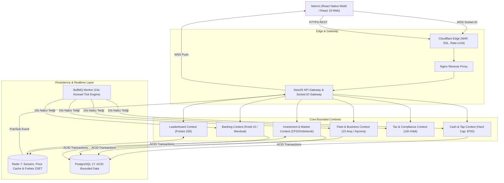

# ⚙️ 02 // TEKNİK MİMARİ BELGESİ (TRD)
## Business Bank Online — MMO Finans & Holding Simülasyonu

---

### 1. Purpose (Belgenin Amacı)
Tüm sistem mimarisini, teknoloji tercihlerini, protokolleri, altyapı bileşenlerini ve veri akış kurallarını baştan netleştirmek; yapay zeka ajanlarının ve mühendislerin uyumsuz paketler kurmasını, rastgele mimari kararlar almasını veya tahmin yürütmesini tamamen engellemek.

---

### 2. Platforms (Platform Kapsamı)
* **Mobil:** Android (API 26+ / Android 8.0+) & iOS (iOS 15.0+) — React Native 0.79+ / Expo SDK 53.
* **Web:** Masaüstü & Mobil Tarayıcılar (Chrome 110+, Safari 16+, Firefox 115+, Edge) — React 19 + Vite 6 Single Page App (PWA).
* **Backend:** Dağıtık Node.js 22 LTS container mimarisi.

---

### 3. Frontend and Hosting (Önyüz & Barındırma Mimarisi)
* **Mobil Kod Tabanı:** `simsek-business/` (React Native, Expo, Nativewind / Tailwind, React Navigation 7, Zustand 5, Reanimated 3).
* **Web İstemci Kod Tabanı:** `business-bank-web/` (React 19, TypeScript 5.x, Vite 6, Tailwind CSS 4, Lucide Icons, Recharts).
* **Ortak Paket (`@business-bank/shared`):** Her iki önyüz ve sunucu arasında paylaşılan:
  * TypeScript interface ve DTO'lar.
  * Matematiksel finans formülleri (Bileşik faiz, araç aşınma katsayısı, vergi dilimleri, amortisman).
  * Hata kodları ve WebSocket event isimleri.
* **Mobil Dağıtım:** Expo Application Services (EAS Build) -> Google Play Console (AAB) & Apple App Store.
* **Web Dağıtım:** Nginx Reverse Proxy + Cloudflare Enterprise CDN / Edge Cache (`https://businessbank.simsekgame.com`).

---

### 4. Backend and Database (Sunucu & Veritabanı Yığını)
* **Backend Runtime:** Node.js 22 LTS (TypeScript 5.x).
* **Framework:** NestJS 11 — Katı modüler yapı, Domain-Driven Design (DDD), yerleşik WebSocket Gateway, Dependency Injection, CQRS desteği.
* **ORM:** Prisma 6 (Type-safe schema, otomatik migrasyon, güçlü transaction yönetimi).
* **Birincil Veritabanı (RDBMS):** PostgreSQL 17
  * Katı ACID garantisi.
  * Borsa ve bakiye transferlerinde çifte harcamayı (double-spending) önleyen `SELECT ... FOR UPDATE` pessimistic locking mekanizması.
  * JSONB veri tipi desteği (dinamik portföy snapshotları için).
* **Önbellek & Canlı State:** Redis 7 (Valkey)
  * Canlı kur ve borsa fiyat cache'i.
  * Redis Sorted Sets (`ZSET`): Gerçek zamanlı Forbes Leaderboard (O(log(N)) sıralama maliyeti).
  * WebSocket bağlantı oturumları ve multi-node Pub/Sub senkronizasyonu.
* **Zamanlayıcı & Kuyruk Motoru:** BullMQ 5 (Redis tabanlı)
  * 10 saniyelik küresel Tick Nabzı (Pulse Engine).
  * Saatlik kredi taksit tahsilatı ve amortisman işleme işleri.
  * 16 saatlik vergi borcu denetleme kuyruğu.
* **Sunucu Bölgesi:** Frankfurt / Amsterdam (Düşük gecikmeli Avrupa Veri Merkezi, Tier III+ altyapı).

---

### 5. Authentication and Roles (Kimlik Doğrulama & Roller)
* **Giriş Yöntemleri:**
  1. **Misafir Modu (Guest Mode):** Cihaz donanım parmak izi (UUID + Android ID / iOS Vendor Identifier) ile sıfır sürtünmeli anında başlangıç.
  2. **Sosyal Giriş:** Google OAuth 2.0 & Apple Sign-In (Mobil ve Web uyumlu).
  3. **Standart Giriş:** Email & Argon2id ile hashlenmiş şifre.
* **Token Mimarisi:**
  * **Access Token:** JWT (15 dakika geçerli; `userId`, `role`, `vipCardTier` payload).
  * **Refresh Token:** Kriptografik rastgele string (30 gün geçerli, DB'de hashli saklanır; mobil `SecureStore`, web `HttpOnly Cookie`).
* **Kullanıcı Rolleri & İzinler:**
  * `Player`: Standart oyun hakları, borsa işlemleri, filo yönetimi.
  * `VerifiedInvestor`: Hesabını e-posta/sosyal ağ ile bağlamış oyuncu (halka arz açma hakkı kazanır).
  * `ForbesElite`: Dünyada ilk 200'e giren oyuncu (Özel rozet, piyasa analisti erişimi).
  * `GameMaster` (Admin): Pazar olaylarını tetikleme, hile inceleme, hesap dondurma/açma.
  * `Auditor`: Salt-okunur finansal ve ekonomik denetim loglarını inceleme yetkisi.

---

### 6. External Services and APIs (Harici Servisler)
* **Push Bildirimleri:** Firebase Cloud Messaging (FCM) & Apple Push Notification Service (APNs) — Vergi uyarısı, halka arz bildirimi ve kredi taksit hatırlatması.
* **Stokastik Fiyat Simülatörü:** Sovereign Finans Motoru (Geometric Brownian Motion ve Mean Reversion formülleriyle çalışan, gerçek dünya API bağımlılığı olmayan otonom borsa motoru).
* **Statik Depolama:** Cloudflare R2 / AWS S3 (Kullanıcı avatarları ve oyun içi araç/kart görsel assetleri).
* **İzleme & APM:** Prometheus & Grafana (Tick süresi, WebSocket bağlantı sayısı, Redis bellek tüketimi).

---

### 7. Architecture & Data Movement (Sistem Mimarisi & Veri Akışı)

---

### 8. Security and Privacy (Güvenlik & Gizlilik)
* **%100 Server-Authoritative Karar:** İstemciden (client) gelen "param şu kadar arttı" verisi kesinlikle kabul edilmez. İstemci yalnızca `TAP_EVENT`, `BUY_ORDER`, `REPAIR_VEHICLE` niyetini iletir. Tüm hesaplamalar sunucu tarafında yapılır.
* **Anti-Cheat & Rate Limiting:**
  * Dokunma tavanı: Maksimum 15 tık/saniye. Aşan istekler sessizce drop edilir; sürekli aşımda bot flag'i açılır.
  * REST API: IP başına dakikada maksimum 120 istek.
* **Pessimistic Locking (`SELECT ... FOR UPDATE`):** Para transferi, borsa emri ve kredi işlemlerinde aynı cüzdan satırı kilitlenir; yarış durumu (race condition) ve çifte harcama engellenir.
* **Veri Gizliliği:** KVKK ve GDPR uyumlu. Şifreler Argon2id, hassas veriler AES-256-GCM ile korunur.

---

### 9. Performance and Reliability Targets (Performans & Güvenilirlik)
* **REST API Response Time:** p95 < 50ms, p99 < 120ms.
* **WebSocket Message Round-Trip:** < 45ms.
* **Tick Engine (50.000 CCU):** 10 saniyelik küresel nabzın BullMQ batch partition (1.000'lik parçalar) ile işlenmesi < 1.400 ms.
* **Veritabanı Connection Pool:** PgBouncer ile yönetilen maksimum 200 connection havuzu.
* **Yedekleme:** Günlük otomatik soğuk yedekleme, saatlik PostgreSQL WAL archiving (RPO < 5 dakika, RTO < 30 dakika).

---

### 10. Environments and Delivery (Ortamlar & CI/CD)
* **Development (Yerel):** Docker Compose (Local Postgres 17, Redis 7, NestJS Hot-reload, Vite Web, Expo Go).
* **Staging:** İzole VPS / Kubernetes pod (`staging-api.simsekgame.com`), test veritabanı, otomatik test pipeline.
* **Production:** Yüksek erişilebilirlikli sunucu kümesi, Cloudflare WAF, otomatik Nginx SSL.
* **CI/CD Pipeline (GitHub Actions):**
  1. TypeScript Type-Check & ESLint (`npm run lint`).
  2. Jest Unit & E2E Testleri (`npm run test:e2e`).
  3. Docker Image Build & Registry Push.
  4. SSH Deploy & Zero-Downtime Reload (`pm2 reload` / rolling restart).

---

### 11. Key Technical Decisions and Tradeoffs (Kritik Kararlar & Ödünleşimler)

| Karar | Seçilen | Alternatif | Neden Seçildi? / Ödünleşim |
|---|---|---|---|
| **Veritabanı** | PostgreSQL 17 | MongoDB | Finansal veride ACID ve pessimistic locking zorunludur. MongoDB'nin esnek şeması yerine katı ilişkisel tutarlılık tercih edildi. |
| **Backend Dili** | TypeScript / NestJS | Go / Rust | React Native ekosistemiyle %100 DTO ve iş kuralı paylaşımı sağlandı. Go daha hızlı olsa da çift kod yazma maliyetinden kaçınıldı. |
| **Gerçek Zamanlı** | Socket.IO (Redis Adapter) | Raw WebSockets | Dahili oda (room) sistemi, otomatik yeniden bağlanma ve Redis pub/sub adaptörü hazır olduğu için operasyonel hız kazandırdı. |
| **Arka Plan Motoru** | BullMQ (Redis) | RabbitMQ / Kafka | Halihazırda var olan Redis altyapısını kullanarak ek sunucu/mesaj kuyruğu bakım maliyetinden ve karmaşıklıktan tasarruf edildi. |
