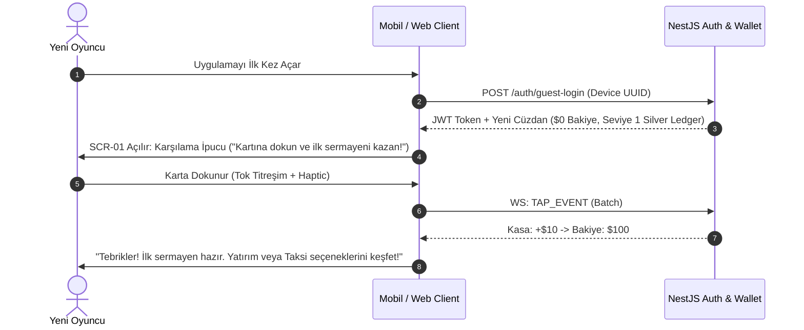

# 🗺️ 03 // KULLANICI YOLCULUĞU & NAVİGASYON (APP FLOW)
## Business Bank Online — MMO Finans & Holding Simülasyonu

---

### 1. Purpose (Belgenin Amacı)
Kullanıcının uygulamada nasıl gezeceğini, her ekranda ne göreceğini, bir butona veya karta tıkladığında nereye gideceğini; ekranların yükleme, hata ve kilitlenme durumlarını haritalandırarak ön yüz geliştiricisi veya AI ajanının tahmin yürütmesini engellemek.

---

### 2. Entry Points (Uygulamaya Giriş Noktaları)
1. **Mobil Uygulama Başlatma:** Uygulama İkonu -> `SCR-00 (Splash Screen)` -> Oturum / Cihaz UUID Kontrolü -> `SCR-01 (Dashboard)`.
2. **Web Girişi:** `https://businessbank.simsekgame.com` -> Tarayıcı PWA Shell -> Otomatik Misafir Oturumu / JWT -> `SCR-01 (Dashboard)`.
3. **Derin Bağlantılar (Deep Links):**
   * `businessbank://market/BTC` -> Doğrudan `SCR-02` (Kripto Ticaret Paneli).
   * `businessbank://fleet/veh_15` -> Doğrudan `SCR-03` (Sovereign S1 Garaj Vitrini).
   * `businessbank://bank/loan` -> Doğrudan `SCR-04` (Kredi Başvuru Paneli).
   * `businessbank://forbes` -> Doğrudan `SCR-06` (Forbes Dünya Sıralaması).

---

### 3. Screen Inventory (Ekran Envanteri)

| Ekran Kodu | Ekran Adı | Temel Amacı | Gereken Veri (Payload) |
|---|---|---|---|
| **SCR-00** | **Splash & Loader** | Kimlik doğrulama, asset ve sunucu bağlantısı kontrolü. | Cihaz UUID, Refresh Token. |
| **SCR-01** | **Dashboard (Kazançlar)** | Ana kontrol merkezi, dokunmatik bakiye kazanma, 10s nabız sayacı. | Cüzdan bakiyesi, tık seviyesi, saatlik net getiri. |
| **SCR-02** | **Finansal Piyasalar (Yatırım)** | Canlı borsa, kripto, forex ve emtia alım-satımı, grafikler. | Sembol fiyatları, portföy hisseleri, emir defteri. |
| **SCR-03** | **Otonom Filo (İşletme)** | 15 modelli araç kataloğu, taksi filosu açma, km ve bakım yönetimi. | Sahip olunan araçlar, aşınma oranları, gelirler. |
| **SCR-04** | **Sovereign Bank (Banka)** | Kredi çekme, vadeli mevduat yatırma, şirket halka arzı (IPO). | Kredi limiti, aktif borçlar, mevduat faiz oranları. |
| **SCR-05** | **Gayrimenkul İmparatorluğu** | Daire, rezidans, AVM ve plaza mülk yatırımları ve yükseltmeler. | Mülk kataloğu, sahip olunan gayrimenkuller, kira. |
| **SCR-06** | **Profil, Bilanço & Forbes** | Konsolide net varlık, 16h vergi durumu, Forbes sıralaması, VIP kart. | Toplam net değer, vergi borcu, Forbes sıralaması. |

---

### 4. First-Use Journey (İlk Kullanım & Onboarding Yolculuğu)

---

### 5. Primary Journey (Sıfırdan Dünyanın En Zengine Yolculuk)
1. **Adım 1:** `SCR-01 (Dashboard)` -> Oyuncu kartına dokunur ($0 -> $10.000 sermaye biriktirir).
2. **Adım 2:** `SCR-02 (Yatırım)` veya `SCR-03 (Filo)` -> Kripto/Forex pozisyonu açar veya ilk 2024 Fiat Egea taksisini kurar.
3. **Adım 3:** `SCR-05 (Gayrimenkul)` -> Pasif gelir akışıyla stüdyo daire ve rezidans satın alır.
4. **Adım 4:** `SCR-04 (Banka)` -> Bakiye x 5 kurumsal kredi çeker, kaldıraçlı olarak filoyu Mercedes ve Bentley'e yükseltir.
5. **Adım 5:** `SCR-04 (Banka / IPO)` -> Şirketlerini borsada halka arz eder, yüz milyonlarca dolarlık kurumsal fon toplar.
6. **Adım 6:** `SCR-06 (Forbes)` -> Forbes listesinde 1 numaraya oturur, efsanevi "Sovereign Black" tacını takar ve piyasa şoklarına karşı tahtını savunur.

---

### 6. Alternate Journeys (Alternatif Yolculuklar)
* **Vergi Borcu Ödeme:** `SCR-01` (Kırmızı Uyarı) -> "Vergiyi İncele" Tıkı -> `SCR-06` (Profil) -> "Vergi Borcunu Kapat" Butonu -> `SCR-01` (Gelirler Tekrar Aktif).
* **Araç Bakımı & Hurda Emeklilik:** `SCR-03` -> Araç kondisyonu %20 altına düşer -> "Servise Gönder" Butonu -> Bakım masrafı ödenir -> Kondisyon %100 olur.
* **Borsa Zarar Durdur (Stop-Loss):** `SCR-02` -> Kripto parası düşüşe geçer -> "Piyasa Fiyatından Sat" -> Nakde dönülür ve banka mevduatına aktarılır.
* **Kredi Erken Kapatma:** `SCR-04` -> "Krediyi Erken Kapat" -> Kalan ana para bakiyeden düşer -> Yeni kredi limiti açılır.

---

### 7. Action State Matrix (Tüm Eylemler İçin Durum Tablosu)

| Eylem | Tetikleyici | Doğrulama (Validation) | Yükleme (Loading) | Başarı (Success State) | Hata (Error State) | Sonraki Ekran |
|---|---|---|---|---|---|---|
| **Karta Dokunma** | Karta tıklama/tap | Son tık < 66ms değilse | Yok (Anında lokal haptic) | Floating `+$X`, bakiye artışı | "Çok hızlı dokunuyorsunuz" uyarısı | Aynı ekran |
| **Araç Satın Al** | "Aracı Satın Al" butonu | Kasa >= Araç Fiyatı & Garajda boş slot var | Butonda spinner (150ms) | Garaja eklenir, araç sesi çalar | "Yetersiz Bakiye / Garaj Dolu" | `SCR-03` |
| **Hisse / Kripto Al** | "Satın Al" butonu | Kasa >= (Miktar x Fiyat) | Buton kilitlenir | Portföye eklenir, bakiye düşer | "Likidite Yetersiz / Bakiye Yok" | `SCR-02` |
| **Kredi Başvurusu** | Kredi onay kaydırıcısı | Aktif borç yok & İstenen <= Kasa x 5 | Modalda onay spinnerı | Nakit anında kasaya aktarılır | "Mevcut borcunuzu kapatmalısınız" | `SCR-04` |
| **Mevduata Yatır** | "Mevduat Aç" butonu | Kasa >= Yatırılan Tutar | 200ms işlem süresi | Mevduat kasasına geçer, saatlik faiz başlar | "Yetersiz nakit" | `SCR-04` |
| **Vergiyi Kapat** | "Vergiyi Öde" butonu | Kasa >= Vergi Borcu | Buton kilitlenir | Kırmızı kilit kalkar, yeşil rozet | "Vergi için nakit yetersiz" | `SCR-06` |

---

### 8. Navigation Rules (Navigasyon & Davranış Kuralları)
* **Alt Tab Bar (Bottom Tabs - 5 Ana Sekme):**
  1. `Kazanclar` (`SCR-01`)
  2. `Yatırım` (`SCR-02`)
  3. `İşletme` (`SCR-03`)
  4. `Banka` (`SCR-04`)
  5. `Profil` (`SCR-06`)
* **Geri Tuşu Davranışı (Android / Tarayıcı):**
  * Modal/Sheet açık ise -> Modalı kapatır.
  * Alt sekmelerde ise -> `SCR-01` Dashboard'a yönlendirir.
  * `SCR-01` ekranında ise -> "Oyundan çıkmak istiyor musunuz?" onay diyaloğu gösterir.
* **Sekme Durumunun Korunması (State Preservation):** Sekmeler arası geçiş yapıldığında hiçbir form girdisi veya kaydırma pozisyonu sıfırlanmaz (Zustand persistent state).

---

### 9. Empty and Blocked States (Boş & Kilitli Ekranlar)
* **Boş Portföy (SCR-02):** *"Henüz portföyünüzde hisse veya kripto varlık bulunmuyor. Yukarıdaki canlı listeden ilk yatırımınızı seçin!"* (Rehber yönlendirme butonu ile).
* **Boş Garaj (SCR-03):** *"Filoda hiç aracınız yok. İlk Fiat Egea Sedan taksinizi kurarak pasif nakit akışını başlatın!"*.
* **Vergi Kilidi (Global Blocked State):** 16 saatlik vergi süresi dolduğunda ekranların üzerine yarı saydam kırmızı bir cam filtre biner; üstte *"16 Saati Aşan Vergi Borcu! Tüm gelirler donduruldu."* uyarısı çıkar ve oyuncu doğrudan Profil ekranındaki ödeme butonuna yönlendirilir.
* **Bağlantı Kesintisi (Offline State):** İnternet koptuğunda üstte sarı bir status bar çıkar: *"Çevrimdışı Mod. Sunucu bağlantısı yeniden kuruluyor..."* (Tıklama kazançları yerel kuyruğa alınır, bağlantı gelince batch senkronize edilir).
