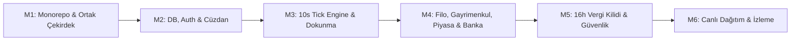

# 🚀 06 // İNŞA SIRALAMASI & FAZ PLANI (IMPLEMENTATION PLAN)
## Business Bank Online — MMO Finans & Holding Simülasyonu

---

### 1. Purpose (Belgenin Amacı)
Geliştirme yapacak AI ajanlarına (Claude Code, Cursor, Devin, Antigravity) ve yazılım ekibine adım adım, bağımlılıkları gözetilmiş, context şişmesini ve token aşımını önleyen **6 fazlı bir inşa sıralaması ve kontrol noktaları (checkpoints)** sunmak.

---

### 2. Milestone Overview (Faz Haritası)

---

### 3. Milestone 1: Monorepo Setup & Shared Core (Proje Kurulumu)
* **Kapsam:** Nx / Turborepo monorepo mimarisi (`apps/web`, `apps/mobile`, `apps/backend`, `packages/shared`). Ortak finans matematik kütüphanesi, TypeScript konfigürasyonları ve linter standartları.
* **Bağımlılıklar:** Yok (Başlangıç fazı).

#### Görev Dökümü (Task Breakdown)
| Görev Kodu | Görev Adı | Sorumlu | Girdiler | Çıktı | Definition of Done (DoD) |
|---|---|---|---|---|---|
| **T1.1** | Monorepo İskeleti | AI Agent | Repo kök dizini | Turborepo / pnpm workspace | `pnpm build` komutu tüm boş paketleri hatasız derlemeli. |
| **T1.2** | Shared Core Paketi | AI Agent | `01-PRD.md` matematik formülleri | `@business-bank/shared` | Bileşik faiz, araç aşınma ve tık gücü fonksiyonlarının unit testleri %100 geçmeli. |
| **T1.3** | Docker Compose Yerel Altyapı | AI Agent | `02-TRD.md` | `docker-compose.yml` | `docker compose up` ile PostgreSQL 17 ve Redis 7 yerelde ayağa kalkmalı. |

> **Checkpoint M1:** `pnpm test` çalıştırılır. Paylaşılan çekirdek matematik fonksiyonlarının testleri yeşil yanmadan M2'ye geçilmez.

---

### 4. Milestone 2: Data, Migrations & Authentication (Veri & Kimlik Altyapısı)
* **Kapsam:** PostgreSQL Prisma şeması, veritabanı migrasyonları, Redis bağlantısı, Misafir (Guest UUID) ve JWT kimlik doğrulama servisleri.
* **Bağımlılık:** Milestone 1.

#### Görev Dökümü (Task Breakdown)
| Görev Kodu | Görev Adı | Sorumlu | Girdiler | Çıktı | Definition of Done (DoD) |
|---|---|---|---|---|---|
| **T2.1** | Prisma Şema & Migration | AI Agent | `05-BACKEND-SCHEMA.md` | `schema.prisma` & SQL migrations | `npx prisma migrate dev` ile tüm tablolar (users, wallets, vehicles vb.) hatasız oluşmalı. |
| **T2.2** | Misafir Giriş & JWT Servisi | AI Agent | NestJS Auth Module | `/auth/guest-login` & `/auth/refresh` | Postman / Jest testinde benzersiz device UUID ile anında 15 dk JWT ve 30 günlük Refresh token dönmeli. |
| **T2.3** | Cüzdan & Bakiye Servisi | AI Agent | NestJS Wallet Module | `/wallet/me` endpoint'i | Her yeni kullanıcıya otomatik olarak $0 bakiyeli ve Seviye 1 kartlı cüzdan açılmalı. |

> **Checkpoint M2:** E2E test çalıştırılır. 50 eş zamanlı misafir girişi simüle edilir; her biri için DB'de tekil kullanıcı ve cüzdan oluştuğu doğrulanır.

---

### 5. Milestone 3: Core User Journey (10s Tick Engine & Dokunmatik Akış)
* **Kapsam:** BullMQ 10 saniyelik küresel nabız (Pulse Engine), Socket.IO WebSocket Gateway, dokunmatik kazanç ($750 hard cap) ve istemci senkronizasyonu.
* **Bağımlılık:** Milestone 2.

#### Görev Dökümü (Task Breakdown)
| Görev Kodu | Görev Adı | Sorumlu | Girdiler | Çıktı | Definition of Done (DoD) |
|---|---|---|---|---|---|
| **T3.1** | BullMQ 10s Nabız Motoru | AI Agent | Redis connection | `PulseTickProcessor` | Her 10 saniyede bir kuyruk tetiklenmeli ve tüm aktif cüzdanlara saatlik gelirin 1/360'ı eklenmeli. |
| **T3.2** | Socket.IO Gateway & Event Sync | AI Agent | NestJS WebSockets | `GameGateway` | Oyuncuya anlık bakiye değişimi WebSocket üzerinden push edilmeli (Gecikme < 50ms). |
| **T3.3** | Dokunmatik Sermaye & Anti-Cheat | AI Agent | `01-PRD.md` AC-01 | `/wallet/tap` WebSocket Event | Seviye 1'de +$10, Seviye 20'de +$750 verilmeli; saniyede 15'ten fazla tık sunucuda reddedilmeli. |
| **T3.4** | SCR-01 Dashboard Entegrasyonu | AI Agent | `03-APP-FLOW.md` & `04-DESIGN-BRIEF.md` | Web & Mobil Ana Ekran | Dokunulduğunda tok haptic titreşim çalmalı, sayılar süzülmeli ve bakiye gerçek zamanlı güncellenmeli. |

> **Checkpoint M3:** İstemci açılır. Karta 20 kez dokunulur; bakiyenin sunucuda doğrulanarak arttığı ve 10 saniyede bir pasif nabzın işlendiği görülür.

---

### 6. Milestone 4: Secondary Features (Filo, Gayrimenkul, Piyasa & Kredi)
* **Kapsam:** 15 araçlık otonom filo yönetimi ve aşınma motoru, gayrimenkul mülkleri, canlı borsa emir defteri ve Sovereign Bank kredi sistemi.
* **Bağımlılık:** Milestone 3.

#### Görev Dökümü (Task Breakdown)
| Görev Kodu | Görev Adı | Sorumlu | Girdiler | Çıktı | Definition of Done (DoD) |
|---|---|---|---|---|---|
| **T4.1** | 15 Araçlık Filo & Garaj Modülü | AI Agent | `taxiData.js` kataloğu | `FleetService` & `SCR-03` | Egea'dan Rolls-Royce'a araç alımı yapılabilmeli; her tick'te araç km'si artmalı ve kondisyon düşmeli. |
| **T4.2** | Finansal Piyasalar (Forex/Kripto) | AI Agent | Geometric Brownian Motion | `MarketService` & `SCR-02` | BTC, ETH, Altın ve Petrol fiyatları anlık dalgalanmalı; alış/satış emriyle portföye eklenmeli. |
| **T4.3** | Sovereign Bank Kredi & Mevduat | AI Agent | `01-PRD.md` AC-03 | `BankingService` & `SCR-04` | Bakiye x 5 kredi çekilebilmeli; 24 saatlik taksitler 10s tick'lerde orantılı olarak kasadan tahsil edilmeli. |
| **T4.4** | Gayrimenkul İmparatorluğu | AI Agent | Emlak veri modeli | `RealEstateService` & `SCR-05` | Stüdyo, rezidans ve plaza satın alınabilmeli; kira çarpanları saatlik gelire yansımalı. |

> **Checkpoint M4:** $15.000 sermaye ile ilk Fiat Egea taksi alınır; $100.000 kredi çekilir; borç taksitlerinin düzenli düştüğü ve taksi gelirinin kasaya aktığı doğrulanır.

---

### 7. Milestone 5: Quality, Security & Tax Enforcement (Vergi Kilidi & Kalite)
* **Kapsam:** 16 saatlik vergi kilidi denetçisi, pessimistic database locking (`FOR UPDATE`), hile korumaları, hata yönetimi ve UI erişilebilirlik testleri.
* **Bağımlılık:** Milestone 4.

#### Görev Dökümü (Task Breakdown)
| Görev Kodu | Görev Adı | Sorumlu | Girdiler | Çıktı | Definition of Done (DoD) |
|---|---|---|---|---|---|
| **T5.1** | 16 Saatlik Vergi Kilidi Denetçisi | AI Agent | `01-PRD.md` AC-02 | `TaxAuditorWorker` | 16 saati aşan ödenmemiş vergi borcunda `is_frozen: true` yapılmalı ve tüm pasif gelirler durdurulmalı. |
| **T5.2** | Pessimistic Lock & Race Condition | AI Agent | PostgreSQL `FOR UPDATE` | Kasa işlem pipeline'ı | Aynı anda gelen 10 eşzamanlı çekim/alım isteği çifte harcama yaratmadan sıralı işlenmeli. |
| **T5.3** | Hata & Kilitli Ekranlar (Error UI) | AI Agent | `03-APP-FLOW.md` Empty States | Global Error Boundary | Vergi kilidinde kırmızı cam filtre biner; bağlantı koptuğunda çevrimdışı sarı uyarı barı çıkar. |
| **T5.4** | WCAG AAA & Dokunma Alanı Testi | AI Agent | `04-DESIGN-BRIEF.md` | CSS & StyleSheet denetimi | Tüm butonlar min 44x44px; metin-kontrast oranı 7:1 testini geçmeli. |

> **Checkpoint M5:** Test kullanıcısının vergi tarihi 16 saat öncesine çekilir; gelirlerin dondurulduğu ve "Vergiyi Kapat" butonuna basınca hesabın açıldığı doğrulanır.

---

### 8. Milestone 6: Release, Monitoring & Live Deployment (Canlıya Çıkış)
* **Kapsam:** Dockerize production cluster, Nginx reverse proxy, Cloudflare CDN, Prometheus & Grafana metrikleri, Google Play Store AAB ve Web canlı yayını.
* **Bağımlılık:** Milestone 5.

#### Görev Dökümü (Task Breakdown)
| Görev Kodu | Görev Adı | Sorumlu | Girdiler | Çıktı | Definition of Done (DoD) |
|---|---|---|---|---|---|
| **T6.1** | Production Docker & PM2 Kümesi | DevOps / AI | Dockerfile & PM2 config | Container cluster | Sunucu yeniden başladığında sıfır veri kaybıyla kendini otomatik ayağa kaldırmalı. |
| **T6.2** | Cloudflare Edge & Cache Ayarı | DevOps / AI | Domain DNS | `businessbank.simsekgame.com` | SSL aktif; statik assetler CDN edge'de önbelleklenmeli; API istekleri bypass edilmeli. |
| **T6.3** | Prometheus & Grafana Dashboard | DevOps / AI | Metrics exporter | Canlı APM Paneli | Tick gecikmesi, aktif WebSocket sayısı ve Redis bellek grafikleri canlı izlenebilmeli. |
| **T6.4** | Geri Alma (Rollback) Test Planı | DevOps / AI | DB backup script | Acil durum senaryosu | Başarısız sürümde tek komutla bir önceki versiyona ve DB snapshot'ına dönülebilmeli. |

> **Son Checkpoint:** Canlı sunucuda 100 test kullanıcısı oluşturulur; canlı borsa kurları, taksi filoları ve vergi motoru 2 saat kesintisiz çalıştırılıp gözlemlenir.

---

### 9. Protocol Execution Rules (Yapay Zeka Ajanları İçin Çalışma Kuralları)
1. **Asla Faz Atlamayın:** Ajan M1 tamamlanmadan M2'ye, M2 tamamlanmadan M3'e geçemez.
2. **DoD Doğrulaması:** Her görev tamamlandığında "Definition of Done" maddesi test edilir ve çalışır durumda olduğu kullanıcıya raporlanır.
3. **Context Koruma:** Her fazda tüm proje geçmişi yerine, yalnızca o anki Milestone ve ilgili `05-BACKEND-SCHEMA.md` verisi verilerek token tüketimi minimumda tutulur.

---

### 10. Sunucu Altyapı Envanteri & Ortam Profili (Server Specification Blueprint)
Canlı dağıtım ve üretim ortamı için gereken resmi sunucu gereksinimleri ve profil envanteri tablosu:

| Parametre | Minimum Gereksinim | Önerilen Üretim (Production) | Canlı Durum / Not |
|---|---|---|---|
| **İşletim Sistemi** | Ubuntu 22.04 LTS x86_64 | Ubuntu 24.04 LTS x86_64 | Linux tabanlı kararlı kernel |
| **İşlemci (vCPU)** | 2 vCPU | 4 - 8 vCPU | BullMQ 10s tick engine ve WebSocket concurreny |
| **Bellek (RAM)** | 4 GB RAM + 2 GB Swap | 8 - 16 GB RAM + 4 GB Swap | Postgres 17 buffer pool ve Redis in-memory cache |
| **Depolama (Disk)** | 40 GB NVMe SSD | 100+ GB NVMe SSD | Günlük DB snapshotları ve WAL archiving |
| **Docker & Compose** | Docker 25+ & Compose v2 | Docker Engine + Swarm/K8s hazır | Container tabanlı izole mikro-servisler |
| **Ağ / Bant Genişliği**| 100 Mbps Port | 1 Gbps Port (Sınırsız Trafik) | 50.000 CCU WebSocket heartbeat & kur akışı |
| **Subdomain Yönlendirmeleri** | - `businessbank.simsekgame.com` - `api.simsekgame.com` - `ws.simsekgame.com` | Nginx Reverse Proxy üzerinden SSL Termination | Cloudflare Full (Strict) SSL |
| **Port & Güvenlik Duvarı (UFW)** | Port 22 (SSH), 80 (HTTP), 443 (HTTPS) açık; 5432 (Postgres) ve 6379 (Redis) dış dünyaya kapalı (localhost only). |

---

### 11. Antigravity IDE Entegrasyonu & Çalışma Metodolojisi
Geliştirmenin **Antigravity IDE** üzerinde hatasız yürütülmesi için belirlenen kural seti:

1. **Workspace Kuralı (`.agents/rules/mmo-protocol.md`):** Antigravity IDE agent'ının her oturumda bu 6 protokol belgesini zorunlu kural olarak yüklemesi.
2. **Sidecar & Inline Test Kontrolü:** Yazılan her kod bloğunun Antigravity IDE terminalinde test edilmesi, derleme hatalarının inline diagnostic lenses ile anında çözülmesi.
3. **Interaktif Faz Onayı:** Her alt görev (Task) tamamlandığında görsel diff (Visual Diff Overlay) incelenerek sonraki adıma geçilmesi.
4. **Subagent Delegasyonu:** Büyük testler veya veri tabanı analizleri gerektiğinde Antigravity `invoke_subagent` mekanizması ile arka planda çalıştırılması.
