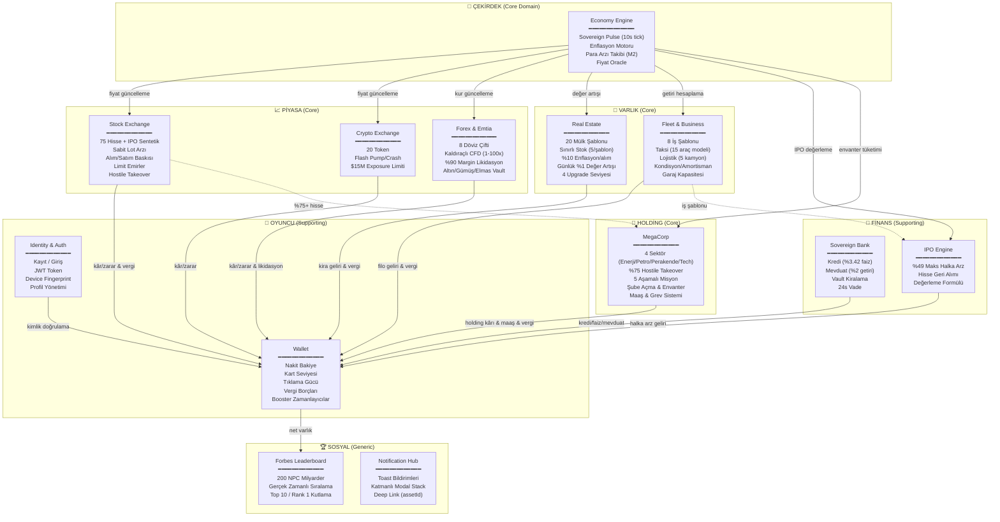

# 📐 RAPOR 1: Yazılım Mimari & Teknoloji Seçimi Raporu

**Proje:** Business Bank Online — MMO Ekonomi Simülasyonu  
**Hazırlayan:** Antigravity Architect  
**Tarih:** 19 Ekim 2026  
**Revizyon:** v1.0  

---

## 1. Yönetici Özeti

Bu rapor, Business Bank oyununun mevcut offline tek-oyuncu yapısından, çok-oyunculu gerçek zamanlı online bir ekonomi simülasyonuna dönüştürülmesi için gerekli **yazılım mimari kararlarını** belgelemektedir.

**Kapsam:**
- Teknoloji stack seçimi ve gerekçeleri
- Domain-Driven Design (DDD) bounded context haritası
- Monorepo yapısı ve kod paylaşım stratejisi
- Web / Android / iOS client mimarileri
- Backend modül yapısı
- Gerçek zamanlı iletişim protokolü (WebSocket)
- Veritabanı şema mimarisi
- API tasarım prensipleri

---

## 2. Teknoloji Stack Seçimi

### 2.1 Backend Stack

| Katman | Seçilen Teknoloji | Alternatifler | Seçim Gerekçesi |
|---|---|---|---|
| **Runtime** | Node.js 22 LTS (TypeScript 5.x) | Go, Rust, Java/Kotlin | React Native ekosistemiyle tam tip uyumu. TS interface'leri client-server arasında paylaşılır. Ekip bilgi birikimi. |
| **Framework** | NestJS 11 | Express, Fastify, Hono | Modüler DDD yapısına native destek. Dependency Injection. Built-in WebSocket Gateway. Guards, Interceptors, Pipes. CQRS/Event Sourcing modülleri. |
| **ORM** | Prisma 6 | TypeORM, Drizzle, Knex | Type-safe schema. Otomatik migration. Performant query engine. JSON field desteği. |
| **Veritabanı** | PostgreSQL 17 | MySQL, CockroachDB, MongoDB | ACID transaksiyonlar (arz-talep atomik işlemler için kritik). `SELECT ... FOR UPDATE` pessimistic locking. JSONB native support. Güçlü indexleme. |
| **Önbellek** | Redis 7 (Valkey) | Memcached, DragonflyDB | Fiyat cache, session yönetimi, pub/sub (multi-node WS senkronizasyonu), rate limiting, leaderboard sorted sets. |
| **Gerçek Zamanlı** | Socket.IO 4.x | ws (raw), µWebSockets | Room/namespace sistemi. Redis Adapter ile multi-node. Otomatik reconnection. Binary desteği. Fallback transport. |
| **Kuyruk** | BullMQ 5 (Redis-based) | RabbitMQ, SQS | Tick işleme, temettü dağıtımı, vergi hesaplama, toplu bildirim gibi ağır asenkron işler. |
| **Auth** | Passport.js + JWT | Auth0, Supabase Auth | Kendi kontrolümüzde. Access + Refresh token. Device fingerprint. |
| **Validation** | class-validator + class-transformer | Zod, Joi | NestJS native entegrasyonu. DTO validation pipeline. |
| **API Dokümantasyonu** | Swagger (via @nestjs/swagger) | — | Otomatik OpenAPI spec. Client SDK üretimi. |

### 2.2 Frontend Stack

| Platform | Seçilen Teknoloji | Gerekçe |
|---|---|---|
| **Android + iOS** | React Native 0.79+ (Expo SDK 53) | Mevcut codebase zaten bu stack. Paylaşılan core paket kullanacak. |
| **Web** | React 19 + Vite 6 | React Native ile aynı hook/store ekosistemi. Vite hızlı dev/build. SSR gereksiz (SPA oyun). |
| **State Management** | Zustand 5 | Mevcut deneyim. Hafif. Middleware desteği (WebSocket sync). |
| **Styling (Web)** | Tailwind CSS 4 + shadcn/ui | Hızlı prototipleme. Responsive. Dark theme native. |
| **Styling (Mobile)** | StyleSheet (mevcut) + Nativewind | Tailwind syntax React Native'de. Web ile tutarlılık. |
| **Navigasyon (Mobile)** | React Navigation 7 | Mevcut altyapı. Deep linking. Tab/Stack/Modal. |
| **Navigasyon (Web)** | React Router 7 | SPA routing. Lazy loading. |
| **Charts** | Victory Native (Mobile) + Recharts (Web) | Platform-optimized chart rendering. |
| **Animasyon** | Reanimated 3 (Mobile) + Framer Motion (Web) | 60fps native driver (mobile). GPU-accelerated (web). |

### 2.3 Paylaşılan Araçlar

| Araç | Amaç |
|---|---|
| **Turborepo** | Monorepo orchestration. Build caching. Task pipeline. |
| **pnpm** | Disk-efficient package manager. Workspace desteği. |
| **TypeScript 5.x** | End-to-end type safety (server ↔ client). |
| **ESLint + Prettier** | Kod kalitesi ve tutarlılık. |
| **Vitest** | Unit ve integration testler. |
| **Docker + Docker Compose** | Geliştirme ortamı ve deployment. |
| **GitHub Actions** | CI/CD pipeline. |

---

## 3. Domain-Driven Design: Bounded Context Haritası

### 3.1 Context Map

Oyunun iş mantığı **9 Bounded Context** altında organize edilmiştir. Her context kendi modülü, kendi entity'leri ve kendi iş kurallarına sahiptir.



### 3.2 Context İlişki Türleri

| Upstream Context | Downstream Context | İlişki Türü | Açıklama |
|---|---|---|---|
| Economy Engine | Stock Exchange | **Conformist** | Borsa, Economy Engine'in ürettiği fiyat sinyallerini olduğu gibi kabul eder |
| Economy Engine | Real Estate | **Conformist** | Gayrimenkul değer artışı Economy Engine tarafından belirlenir |
| Stock Exchange | MegaCorp | **Customer-Supplier** | %75 hostile takeover tetiklemesi borsa portföy verisine bağlıdır |
| Wallet | Forbes | **Published Language** | Net varlık hesaplama formülü tüm context'ler tarafından anlaşılan ortak bir dil kullanır |
| Fleet & Business | IPO Engine | **Shared Kernel** | İş değerleme formülü her iki context tarafından paylaşılır |
| Identity & Auth | Tümü | **Open Host Service** | JWT token doğrulama tüm servislerde aynı guard ile çalışır |

### 3.3 Aggregate Root Haritası

| Bounded Context | Aggregate Root | Child Entities | Value Objects |
|---|---|---|---|
| **Identity** | `User` | — | `Email`, `Password`, `DeviceFingerprint` |
| **Wallet** | `PlayerWallet` | `TaxDebt[]`, `BoosterTimer[]` | `Money`, `CardLevel`, `ClickPower` |
| **Stock Exchange** | `StockListing` | `OrderBook`, `LimitOrder[]` | `Price`, `LotCount`, `DividendYield` |
| **Crypto Exchange** | `CryptoToken` | — | `Price`, `ExposureLimit` |
| **Forex** | `ForexPosition` | — | `Leverage`, `Margin`, `PnL` |
| **Real Estate** | `Property` | `PropertyUpgrade[]` | `Location`, `RentAmount`, `Condition` |
| **Fleet** | `Business` | `VehicleInstance[]`, `GarageUpgrade[]` | `VehicleCondition`, `Mileage` |
| **Bank** | `LoanContract` | — | `Principal`, `InterestRate`, `Installment` |
| **IPO** | `IPOListing` | — | `Valuation`, `SharePrice`, `SoldPercent` |
| **MegaCorp** | `HoldingCompany` | `Branch[]`, `Mission` | `Inventory`, `StaffCount`, `WageDebt` |
| **Forbes** | `LeaderboardEntry` | — | `NetWorth`, `Rank` |

---

## 4. Monorepo Yapısı

```
business-bank-online/
│
├── apps/
│   ├── server/                          # NestJS Backend
│   │   ├── src/
│   │   │   ├── modules/
│   │   │   │   ├── auth/                # Identity & Auth BC
│   │   │   │   │   ├── auth.module.ts
│   │   │   │   │   ├── auth.controller.ts
│   │   │   │   │   ├── auth.service.ts
│   │   │   │   │   ├── strategies/      # JWT, Local, Refresh
│   │   │   │   │   ├── guards/          # JwtAuthGuard, RolesGuard
│   │   │   │   │   └── dto/
│   │   │   │   │
│   │   │   │   ├── wallet/              # Wallet BC
│   │   │   │   │   ├── wallet.module.ts
│   │   │   │   │   ├── wallet.service.ts
│   │   │   │   │   ├── wallet.gateway.ts     # WS events
│   │   │   │   │   ├── tax.service.ts
│   │   │   │   │   ├── click.service.ts
│   │   │   │   │   └── booster.service.ts
│   │   │   │   │
│   │   │   │   ├── economy/             # Economy Engine BC
│   │   │   │   │   ├── economy.module.ts
│   │   │   │   │   ├── sovereign-pulse.service.ts
│   │   │   │   │   ├── inflation.service.ts
│   │   │   │   │   ├── price-oracle.service.ts
│   │   │   │   │   └── money-supply.service.ts
│   │   │   │   │
│   │   │   │   ├── stock-exchange/      # Stock Exchange BC
│   │   │   │   │   ├── stock.module.ts
│   │   │   │   │   ├── stock.service.ts
│   │   │   │   │   ├── stock.gateway.ts      # WS fiyat yayını
│   │   │   │   │   ├── order-book.service.ts
│   │   │   │   │   ├── dividend.service.ts
│   │   │   │   │   └── takeover.service.ts
│   │   │   │   │
│   │   │   │   ├── crypto/              # Crypto Exchange BC
│   │   │   │   │   ├── crypto.module.ts
│   │   │   │   │   ├── crypto.service.ts
│   │   │   │   │   └── crypto.gateway.ts
│   │   │   │   │
│   │   │   │   ├── forex/               # Forex & Emtia BC
│   │   │   │   │   ├── forex.module.ts
│   │   │   │   │   ├── forex.service.ts
│   │   │   │   │   ├── commodity.service.ts
│   │   │   │   │   └── liquidation.service.ts
│   │   │   │   │
│   │   │   │   ├── real-estate/         # Real Estate BC
│   │   │   │   │   ├── real-estate.module.ts
│   │   │   │   │   ├── property.service.ts
│   │   │   │   │   ├── auction.service.ts
│   │   │   │   │   └── upgrade.service.ts
│   │   │   │   │
│   │   │   │   ├── fleet/               # Fleet & Business BC
│   │   │   │   │   ├── fleet.module.ts
│   │   │   │   │   ├── business.service.ts
│   │   │   │   │   ├── vehicle.service.ts
│   │   │   │   │   └── garage.service.ts
│   │   │   │   │
│   │   │   │   ├── bank/                # Sovereign Bank BC
│   │   │   │   │   ├── bank.module.ts
│   │   │   │   │   ├── loan.service.ts
│   │   │   │   │   ├── deposit.service.ts
│   │   │   │   │   └── vault.service.ts
│   │   │   │   │
│   │   │   │   ├── ipo/                 # IPO Engine BC
│   │   │   │   │   ├── ipo.module.ts
│   │   │   │   │   └── ipo.service.ts
│   │   │   │   │
│   │   │   │   ├── megacorp/            # MegaCorp Holding BC
│   │   │   │   │   ├── megacorp.module.ts
│   │   │   │   │   ├── holding.service.ts
│   │   │   │   │   ├── mission.service.ts
│   │   │   │   │   ├── branch.service.ts
│   │   │   │   │   └── wage.service.ts
│   │   │   │   │
│   │   │   │   ├── forbes/              # Forbes Leaderboard BC
│   │   │   │   │   ├── forbes.module.ts
│   │   │   │   │   ├── forbes.service.ts
│   │   │   │   │   └── forbes.gateway.ts
│   │   │   │   │
│   │   │   │   └── notification/        # Notification Hub BC
│   │   │   │       ├── notification.module.ts
│   │   │   │       ├── notification.service.ts
│   │   │   │       └── notification.gateway.ts
│   │   │   │
│   │   │   ├── shared/
│   │   │   │   ├── guards/              # Auth, Rate limit, Anti-cheat
│   │   │   │   ├── interceptors/        # Logging, Transform, Cache
│   │   │   │   ├── filters/             # Exception filters
│   │   │   │   ├── pipes/               # Validation pipes
│   │   │   │   └── domain-events/       # Event bus (CQRS)
│   │   │   │
│   │   │   ├── infrastructure/
│   │   │   │   ├── database/            # Prisma client, migrations
│   │   │   │   ├── redis/               # Redis client, pub/sub
│   │   │   │   ├── websocket/           # Socket.IO adapter config
│   │   │   │   └── queue/               # BullMQ processors
│   │   │   │
│   │   │   └── main.ts
│   │   │
│   │   ├── prisma/
│   │   │   ├── schema.prisma
│   │   │   └── migrations/
│   │   ├── Dockerfile
│   │   └── package.json
│   │
│   ├── mobile/                          # React Native (Android + iOS)
│   │   ├── src/
│   │   │   ├── screens/                 # Mevcut ekranlar (adapte edilecek)
│   │   │   ├── navigation/              # BottomTabNavigator + Stack
│   │   │   ├── platform/               # Native-specific (Haptics, MMKV cache)
│   │   │   ├── adapters/               # WebSocket → Zustand bridge
│   │   │   └── hooks/                  # Platform-specific hooks
│   │   ├── app.json
│   │   └── package.json
│   │
│   └── web/                             # React Web Client
│       ├── src/
│       │   ├── pages/                   # Web-specific sayfalar
│       │   ├── layouts/                 # Responsive layouts
│       │   ├── platform/               # Web-specific (localStorage, Web Audio)
│       │   ├── adapters/               # WebSocket → Zustand bridge
│       │   └── hooks/                  # Web-specific hooks
│       ├── index.html
│       ├── vite.config.ts
│       └── package.json
│
├── packages/
│   ├── core/                            # PAYLAŞILAN İŞ MANTIĞI
│   │   ├── src/
│   │   │   ├── domain/                  # Entity interfaces & Value Objects
│   │   │   │   ├── user.types.ts
│   │   │   │   ├── stock.types.ts
│   │   │   │   ├── property.types.ts
│   │   │   │   ├── vehicle.types.ts
│   │   │   │   ├── loan.types.ts
│   │   │   │   ├── megacorp.types.ts
│   │   │   │   └── economy.types.ts
│   │   │   │
│   │   │   ├── dto/                     # Request/Response DTO'lar
│   │   │   │   ├── auth.dto.ts
│   │   │   │   ├── trade.dto.ts
│   │   │   │   ├── property.dto.ts
│   │   │   │   └── ...
│   │   │   │
│   │   │   ├── events/                  # WebSocket Event Contracts
│   │   │   │   ├── market.events.ts
│   │   │   │   ├── portfolio.events.ts
│   │   │   │   ├── forbes.events.ts
│   │   │   │   └── system.events.ts
│   │   │   │
│   │   │   ├── constants/               # Oyun kuralları & sabitler
│   │   │   │   ├── game-rules.ts        # Tüm eşik değerleri
│   │   │   │   ├── card-levels.ts       # 5 kart seviyesi
│   │   │   │   ├── tax-rates.ts         # Vergi oranları
│   │   │   │   ├── vehicle-catalog.ts   # 15 araç + 5 kamyon
│   │   │   │   ├── property-catalog.ts  # 20 gayrimenkul
│   │   │   │   ├── sector-map.ts        # MegaCorp sektörleri
│   │   │   │   └── stock-catalog.ts     # 75 hisse + 20 kripto
│   │   │   │
│   │   │   ├── stores/                  # Zustand client stores
│   │   │   │   ├── useAuthStore.ts      # Yeni: Auth state
│   │   │   │   ├── useWalletStore.ts    # (eski useUserStore'un client kısmı)
│   │   │   │   ├── useMarketStore.ts    # Fiyat stream receiver
│   │   │   │   ├── usePortfolioStore.ts # Portföy state
│   │   │   │   ├── useForbesStore.ts    # Leaderboard state
│   │   │   │   └── useSocketStore.ts    # WebSocket bağlantı yönetimi
│   │   │   │
│   │   │   ├── hooks/                   # Paylaşılan React hooks
│   │   │   │   ├── useTrading.ts
│   │   │   │   ├── useRealEstate.ts
│   │   │   │   ├── useForbes.ts
│   │   │   │   └── useEconomy.ts
│   │   │   │
│   │   │   └── utils/                   # Yardımcı fonksiyonlar
│   │   │       ├── formatMoney.ts
│   │   │       ├── calculateNetWorth.ts
│   │   │       └── validators.ts
│   │   │
│   │   └── package.json
│   │
│   ├── ui/                              # Paylaşılan UI Bileşenleri
│   │   ├── src/
│   │   │   ├── CreditCard/              # VIP kart render
│   │   │   ├── PriceChart/              # Fiyat grafikleri
│   │   │   ├── ForbesRow/               # Sıralama satırı
│   │   │   ├── TradePanel/              # Alım/satım paneli
│   │   │   ├── NotificationToast/
│   │   │   └── ...
│   │   └── package.json
│   │
│   └── socket-protocol/                 # WebSocket Mesaj Kontratı
│       ├── src/
│       │   ├── events.ts                # Event enum'ları
│       │   ├── payloads.ts              # Payload interface'leri
│       │   ├── channels.ts              # Room/namespace tanımları
│       │   └── errors.ts                # Hata kodları
│       └── package.json
│
├── docker-compose.yml                   # PostgreSQL + Redis + Server
├── docker-compose.prod.yml
├── turbo.json                           # Build pipeline
├── pnpm-workspace.yaml
├── .github/workflows/                   # CI/CD
│   ├── test.yml
│   ├── deploy-server.yml
│   └── build-mobile.yml
└── README.md
```

---

## 5. Backend Modül Mimarisi (NestJS)

### 5.1 Modüler Monolith Yaklaşımı

> [!IMPORTANT]
> **Neden Microservice DEĞİL?**  
> Başlangıçta modüler monolith tercih edilmiştir çünkü:
> - Tek geliştirici/küçük ekip için operasyonel karmaşıklık minimum
> - Transaction sınırları modül içinde kalır (distributed tx gereksiz)
> - Gerekirse ileride modüller bağımsız servislere ayrılabilir
> - Deploy, debug ve monitoring çok daha basit

### 5.2 Her Modülün İç Yapısı (Hexagonal Architecture)

```
stock-exchange/
├── stock.module.ts              # NestJS Module tanımı
├── application/                 # Use Case Layer
│   ├── commands/
│   │   ├── buy-stock.command.ts
│   │   ├── sell-stock.command.ts
│   │   └── place-limit-order.command.ts
│   ├── queries/
│   │   ├── get-stock-list.query.ts
│   │   ├── get-portfolio.query.ts
│   │   └── get-order-book.query.ts
│   └── handlers/               # CQRS Handlers
│       ├── buy-stock.handler.ts
│       └── ...
├── domain/                      # Domain Layer (Pure Business Logic)
│   ├── entities/
│   │   ├── stock-listing.entity.ts
│   │   └── limit-order.entity.ts
│   ├── value-objects/
│   │   ├── price.vo.ts
│   │   └── lot-count.vo.ts
│   ├── events/
│   │   ├── stock-purchased.event.ts
│   │   └── price-updated.event.ts
│   └── services/
│       ├── price-calculator.service.ts
│       └── order-matcher.service.ts
├── infrastructure/              # Infrastructure Layer
│   ├── repositories/
│   │   ├── stock.repository.ts
│   │   └── portfolio.repository.ts
│   └── adapters/
│       └── redis-price-cache.adapter.ts
└── presentation/                # Presentation Layer
    ├── stock.controller.ts      # REST endpoints
    ├── stock.gateway.ts         # WebSocket gateway
    └── dto/
        ├── buy-stock.dto.ts
        └── stock-list-response.dto.ts
```

### 5.3 Domain Event Bus (CQRS Pattern)

```typescript
// Modüller arası iletişim Domain Event'ler ile sağlanır
// Doğrudan import YOKTUR — loose coupling

// stock-exchange modülü yayınlar:
@EventHandler(StockPurchasedEvent)
export class StockPurchasedHandler {
  handle(event: StockPurchasedEvent) {
    // → Wallet modülü dinler: bakiye güncelle
    // → Forbes modülü dinler: net worth yeniden hesapla
    // → MegaCorp modülü dinler: hostile takeover kontrolü
  }
}
```

---

## 6. WebSocket İletişim Mimarisi

### 6.1 Namespace ve Room Yapısı

```typescript
// socket-protocol/src/channels.ts

export const WS_NAMESPACES = {
  MARKET: '/market',          // Borsa, kripto, emtia fiyat akışları
  PORTFOLIO: '/portfolio',    // Kişisel portföy (private)
  REAL_ESTATE: '/realestate', // Gayrimenkul piyasası
  FLEET: '/fleet',            // Filo ve araç
  FORBES: '/forbes',          // Küresel sıralama
  SYSTEM: '/system',          // Sistem bildirimleri
} as const;

export const WS_ROOMS = {
  // Market namespace
  ALL_STOCKS: 'stocks:all',
  ALL_CRYPTO: 'crypto:all',
  ALL_COMMODITY: 'commodity:all',
  STOCK_DETAIL: (id: string) => `stock:${id}`,
  
  // Portfolio namespace (private per user)
  USER_PORTFOLIO: (userId: string) => `user:${userId}`,
  
  // Real Estate namespace
  LISTINGS: 'listings',
  AUCTIONS: 'auctions',
  
  // Forbes namespace
  TOP_100: 'top100',
  
  // System namespace
  GLOBAL: 'global',
} as const;
```

### 6.2 Event Kontratları

```typescript
// socket-protocol/src/events.ts

// ──── Client → Server (Commands) ────
export enum ClientEvent {
  // Clicker
  TAP = 'tap',
  ACTIVATE_BOOSTER = 'activate_booster',
  
  // Trading
  BUY_STOCK = 'buy_stock',
  SELL_STOCK = 'sell_stock',
  PLACE_LIMIT_ORDER = 'place_limit_order',
  CANCEL_LIMIT_ORDER = 'cancel_limit_order',
  
  // Real Estate
  BUY_PROPERTY = 'buy_property',
  SELL_PROPERTY = 'sell_property',
  UPGRADE_PROPERTY = 'upgrade_property',
  
  // Fleet
  BUY_VEHICLE = 'buy_vehicle',
  MAINTAIN_VEHICLE = 'maintain_vehicle',
  BUY_BUSINESS = 'buy_business',
  
  // Bank
  APPLY_LOAN = 'apply_loan',
  REPAY_LOAN = 'repay_loan',
  DEPOSIT = 'deposit',
  WITHDRAW = 'withdraw',
  
  // Forex
  OPEN_FOREX_POSITION = 'open_forex_position',
  CLOSE_FOREX_POSITION = 'close_forex_position',
  EXCHANGE_CURRENCY = 'exchange_currency',
  
  // MegaCorp
  UNLOCK_BOARD = 'unlock_board',
  START_MISSION = 'start_mission',
  OPEN_BRANCH = 'open_branch',
  HIRE_STAFF = 'hire_staff',
  RESTOCK = 'restock',
  PAY_WAGES = 'pay_wages',
  
  // Forbes
  SUBSCRIBE_FORBES = 'subscribe_forbes',
  
  // Tax
  PAY_TAX = 'pay_tax',
  PAY_ALL_TAXES = 'pay_all_taxes',
}

// ──── Server → Client (Events) ────
export enum ServerEvent {
  // Market data (broadcast)
  STOCK_PRICES_UPDATED = 'stock_prices_updated',
  CRYPTO_PRICES_UPDATED = 'crypto_prices_updated',
  FX_RATES_UPDATED = 'fx_rates_updated',
  MARKET_EVENT = 'market_event',
  
  // Personal (unicast)
  BALANCE_UPDATED = 'balance_updated',
  TRADE_CONFIRMED = 'trade_confirmed',
  TRADE_REJECTED = 'trade_rejected',
  LIMIT_ORDER_FILLED = 'limit_order_filled',
  TAX_DEBT_UPDATED = 'tax_debt_updated',
  INCOME_RECEIVED = 'income_received',
  FOREX_LIQUIDATED = 'forex_liquidated',
  
  // Real Estate (broadcast)
  PROPERTY_SOLD = 'property_sold',
  PROPERTY_LISTED = 'property_listed',
  AUCTION_BID = 'auction_bid',
  AUCTION_ENDED = 'auction_ended',
  
  // Forbes (broadcast)
  FORBES_UPDATED = 'forbes_updated',
  PLAYER_RANK_CHANGED = 'player_rank_changed',
  
  // MegaCorp (unicast)
  MISSION_COMPLETED = 'mission_completed',
  BRANCH_CONSTRUCTED = 'branch_constructed',
  HOLDING_STRIKE = 'holding_strike',
  
  // System (broadcast)
  ECONOMY_SNAPSHOT = 'economy_snapshot',
  SERVER_ANNOUNCEMENT = 'server_announcement',
  
  // Errors
  ERROR = 'error',
}
```

### 6.3 Mesaj Optimizasyonu

```typescript
// Tick başına gönderilen veri boyutunu minimumda tutmak için:

// ❌ YANLIŞ — Her tick'te 75 hissenin tüm verisini göndermek
{ stocks: [{ id, name, sector, price, change, high, low, ... }, ...] } // ~15KB

// ✅ DOĞRU — Sadece değişen fiyatları delta olarak göndermek
{ 
  t: 1729331200,  // timestamp
  s: {             // stock deltas (sadece değişenler)
    "ATYR": [145.20, 0.45],   // [newPrice, changePercent]
    "GOOGL": [2840.50, -0.12],
    // ... sadece 10-15 hisse değişmiş olabilir
  }
} // ~200 bytes
```

---

## 7. API Tasarım Prensipleri

### 7.1 REST + WebSocket Hibrit Yaklaşım

| İşlem Türü | Protokol | Gerekçe |
|---|---|---|
| **Kayıt / Giriş** | REST (POST) | Tek seferlik, stateless |
| **Profil güncelleme** | REST (PATCH) | Nadir, stateless |
| **Hisse alım/satım** | WebSocket (Command) | Gerçek zamanlı, düşük gecikme |
| **Fiyat akışları** | WebSocket (Broadcast) | Sürekli, push-based |
| **Portföy sorgulama** | REST (GET) | İlk yüklemede cache'lenebilir |
| **Forbes sıralama** | WebSocket (Subscribe) | Canlı güncelleme |
| **Tıklama** | WebSocket (Command) | Yüksek frekans (saniyede 15'e kadar) |
| **Gayrimenkul listesi** | REST (GET) + WS (Subscribe) | İlk yükleme REST, sonra canlı WS |

### 7.2 REST Endpoint Özeti

```
Auth:
  POST   /api/auth/register
  POST   /api/auth/login
  POST   /api/auth/refresh
  POST   /api/auth/logout

User:
  GET    /api/users/me
  PATCH  /api/users/me/profile
  GET    /api/users/me/stats

Market:
  GET    /api/market/stocks
  GET    /api/market/stocks/:id
  GET    /api/market/crypto
  GET    /api/market/economy       # Enflasyon, M2, fiyat endeksi

Portfolio:
  GET    /api/portfolio
  GET    /api/portfolio/history
  GET    /api/portfolio/orders

Real Estate:
  GET    /api/realestate/listings
  GET    /api/realestate/owned

Fleet:
  GET    /api/fleet/businesses
  GET    /api/fleet/businesses/:id/vehicles

Bank:
  GET    /api/bank/status          # Kredi, mevduat, döviz
  GET    /api/bank/forex/positions

Forbes:
  GET    /api/forbes/top100
  GET    /api/forbes/me

MegaCorp:
  GET    /api/megacorp/holdings
  GET    /api/megacorp/missions
```

---

## 8. Client Mimarileri

### 8.1 Mobile Client (React Native)

```
Mevcut Yapı:                         Yeni Yapı:
┌──────────────────────┐             ┌──────────────────────┐
│  Zustand Stores      │             │  @bb/core Stores     │
│  (Tüm iş mantığı    │ ──────────> │  (Sadece UI state +  │
│   + veri + hesaplama)│             │   server cache)      │
├──────────────────────┤             ├──────────────────────┤
│  MMKV Storage        │             │  Socket.IO Client    │
│  (Tüm kalıcı veri)  │ ──────────> │  + REST API Client   │
├──────────────────────┤             ├──────────────────────┤
│  Engine Store        │             │  MMKV (Sadece        │
│  (10s client pulse)  │ ──────────> │   offline cache +    │
└──────────────────────┘             │   auth tokens)       │
                                     └──────────────────────┘
```

**Değişenler:**
- Store'lar artık hesaplama yapmaz, sadece sunucudan gelen veriyi tutar
- MMKV sadece offline cache ve token saklama için kullanılır
- Engine Store kaldırılır (tick sunucuda çalışır)
- WebSocket bridge store'ları otomatik günceller

### 8.2 Web Client (React + Vite)

```
┌──────────────────────────────────────────┐
│              React Web App               │
├──────────────────────────────────────────┤
│  Pages:                                  │
│  ├── LoginPage                           │
│  ├── DashboardPage (= KazanclarScreen)  │
│  ├── TradingPage (= YatirimScreen)      │
│  ├── BusinessPage (= IsletmeScreen)     │
│  ├── BankPage (= BankaScreen)           │
│  ├── ProfilePage (= ProfilScreen)       │
│  └── ForbesPage (= ForbesScreen)        │
├──────────────────────────────────────────┤
│  @business-bank/core                     │
│  ├── stores/     (Zustand - aynı)       │
│  ├── hooks/      (useTrading - aynı)    │
│  ├── constants/  (game rules - aynı)    │
│  └── events/     (WS protocol - aynı)   │
├──────────────────────────────────────────┤
│  Platform Adapter:                       │
│  ├── localStorage (vs MMKV)             │
│  ├── Web Audio API (vs Haptics)         │
│  ├── CSS animations (vs Reanimated)     │
│  └── Mouse click (vs Touch)             │
└──────────────────────────────────────────┘
```

### 8.3 Kod Paylaşım Oranı (Tahmini)

| Katman | Web & Mobile Paylaşım | Platform-Specific |
|---|---|---|
| Domain Types | **%100** paylaşılır | — |
| Game Constants | **%100** paylaşılır | — |
| WS Protocol | **%100** paylaşılır | — |
| Zustand Stores | **%95** paylaşılır | Storage adapter farklı |
| Custom Hooks | **%90** paylaşılır | Platform hooks farklı |
| UI Components | **%30-50** paylaşılır | Native vs DOM render |
| Navigation | **%0** | Tamamen farklı (RN Nav vs React Router) |
| Animations | **%0** | Reanimated vs Framer Motion |

> **Tahmini toplam kod paylaşımı: %60-70**

---

## 9. Veritabanı Şema Mimarisi

### 9.1 Prisma Schema (Özet)

```prisma
// prisma/schema.prisma

generator client {
  provider = "prisma-client-js"
}

datasource db {
  provider = "postgresql"
  url      = env("DATABASE_URL")
}

// ──── Identity & Auth ────
model User {
  id             String   @id @default(uuid())
  email          String   @unique
  username       String   @unique @db.VarChar(30)
  passwordHash   String
  
  // Oyun Durumu
  wallet         Wallet?
  portfolio      StockHolding[]
  properties     Property[]
  vehicles       Vehicle[]
  businesses     Business[]
  loans          Loan[]
  forexPositions ForexPosition[]
  holdings       HoldingCompany[]
  transactions   Transaction[]
  
  // Meta
  isVIP          Boolean  @default(false)
  language       String   @default("tr") @db.VarChar(5)
  profileImage   String?
  userTitle      String   @default("Girişimci") @db.VarChar(50)
  lastSeenAt     DateTime @default(now())
  createdAt      DateTime @default(now())
  
  @@index([lastSeenAt])
}

// ──── Wallet (1:1 with User) ────
model Wallet {
  id              String   @id @default(uuid())
  userId          String   @unique
  user            User     @relation(fields: [userId], references: [id])
  
  cashBalance     Decimal  @default(50000) @db.Decimal(20, 2)
  reservedBalance Decimal  @default(0) @db.Decimal(20, 2)
  
  cardLevel       Int      @default(1)
  maxCardLevel    Int      @default(1)
  clickPower      Int      @default(1)
  clickPowerLevel Int      @default(1)
  totalClicks     BigInt   @default(0)
  
  // Vergi Borçları
  businessTaxDebt    Decimal  @default(0) @db.Decimal(20, 2)
  realEstateTaxDebt  Decimal  @default(0) @db.Decimal(20, 2)
  stocksTaxDebt      Decimal  @default(0) @db.Decimal(20, 2)
  holdingTaxDebt     Decimal  @default(0) @db.Decimal(20, 2)
  businessLastPaid   DateTime @default(now())
  realEstateLastPaid DateTime @default(now())
  stocksLastPaid     DateTime @default(now())
  holdingLastPaid    DateTime @default(now())
  
  // Booster Zamanlayıcılar
  overclockEndTime            DateTime?
  businessTurboEndTime        DateTime?
  forexZeroCommissionEndTime  DateTime?
  bankLoanBoostEndTime        DateTime?
  bankDepositBoostEndTime     DateTime?
  
  // İstatistikler
  totalClickEarned    Decimal @default(0) @db.Decimal(24, 2)
  totalBizEarned      Decimal @default(0) @db.Decimal(24, 2)
  totalRentEarned     Decimal @default(0) @db.Decimal(24, 2)
  totalStockProfit    Decimal @default(0) @db.Decimal(24, 2)
  totalCryptoProfit   Decimal @default(0) @db.Decimal(24, 2)
  totalCommodityProfit Decimal @default(0) @db.Decimal(24, 2)
  totalDividends      Decimal @default(0) @db.Decimal(24, 2)
  totalHoldingEarned  Decimal @default(0) @db.Decimal(24, 2)
  
  updatedAt DateTime @updatedAt
  
  @@index([cashBalance(sort: Desc)])
}

// ──── Stock Exchange ────
model Stock {
  id              String  @id @db.VarChar(10)
  name            String  @db.VarChar(100)
  symbol          String  @db.VarChar(10)
  country         String  @db.VarChar(5)
  sector          String?
  risk            String  @default("standard")
  
  totalShares     Int
  availableShares Int
  currentPrice    Decimal @db.Decimal(14, 4)
  initialPrice    Decimal @db.Decimal(14, 4)
  previousClose   Decimal? @db.Decimal(14, 4)
  dayHigh         Decimal? @db.Decimal(14, 4)
  dayLow          Decimal? @db.Decimal(14, 4)
  
  volatility      Decimal @default(0.02) @db.Decimal(6, 4)
  beta            Decimal @default(1.0) @db.Decimal(4, 2)
  dividendYield   Decimal @default(0) @db.Decimal(8, 6)
  
  buyPressure     Decimal @default(0) @db.Decimal(20, 2)
  sellPressure    Decimal @default(0) @db.Decimal(20, 2)
  
  holdings        StockHolding[]
  limitOrders     LimitOrder[]
  
  updatedAt       DateTime @updatedAt
}

model StockHolding {
  id             String  @id @default(uuid())
  userId         String
  stockId        String
  user           User    @relation(fields: [userId], references: [id])
  stock          Stock   @relation(fields: [stockId], references: [id])
  
  lots           Decimal @db.Decimal(16, 4)
  avgPrice       Decimal @db.Decimal(14, 4)
  reservedLots   Decimal @default(0) @db.Decimal(16, 4)
  
  @@unique([userId, stockId])
  @@index([userId])
}

// ... (diğer modeller benzer pattern)
```

---

## 10. Güvenlik Mimarisi

### 10.1 Kimlik Doğrulama Akışı

```
Register → Hash password (bcrypt, 12 rounds) → Store → JWT pair
Login    → Verify password → Issue access token (15m) + refresh token (7d)
WS Auth  → Client sends JWT in handshake → Server validates → Assigns userId to socket
```

### 10.2 Yetkilendirme Katmanları

| Katman | Mekanizma | Koruma |
|---|---|---|
| **Transport** | HTTPS / WSS | Man-in-the-middle |
| **Auth** | JWT + Refresh Token | Kimlik doğrulama |
| **Rate Limit** | Redis sliding window | DDoS, spam |
| **Input Validation** | class-validator DTO | Injection, overflow |
| **Business Rules** | Server-side guards | Cheat prevention |
| **Anti-Cheat** | Click rate analysis + server authority | Auto-clicker, memory hack |
| **CORS** | Whitelist origins | Cross-origin attacks |
| **Helmet** | Security headers | XSS, clickjacking |

### 10.3 Anti-Cheat: Client → Server Paradigma Değişimi

```
MEVCUT (Offline):                    YENİ (Online):
┌──────────────┐                     ┌──────────────┐
│   CLIENT     │                     │   CLIENT     │
│              │                     │              │
│  clickPower  │                     │  tap event   │──┐
│  × cardMult  │                     │  (sadece     │  │
│  × overclock │                     │   timestamp) │  │
│  = gelir     │                     └──────────────┘  │
│              │                                       │
│  balance +=  │                     ┌──────────────┐  │
│  (GÜVENSİZ) │                     │   SERVER     │<─┘
└──────────────┘                     │              │
                                     │  clickPower  │
                                     │  × cardMult  │
                                     │  × overclock │
                                     │  = gelir     │
                                     │              │
                                     │  balance +=  │
                                     │  (GÜVENLİ)  │
                                     └──────────────┘
```

---

> [!NOTE]
> Bu rapor yazılım mimari kararlarını kapsamaktadır. Teknik altyapı gereksinimleri (sunucu, veritabanı boyutlandırma, hosting) **Rapor 2**'de, platform-spesifik gereksinimler **Rapor 3**'te, mevcut koddan yeni mimariye geçiş detayları **Rapor 4**'te ele alınmaktadır.
