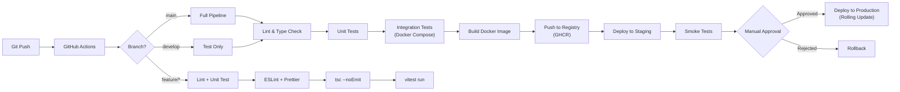

# 🖥️ RAPOR 2: Teknik Altyapı & Kaynak Gereksinimleri Raporu

**Proje:** Business Bank Online — MMO Ekonomi Simülasyonu  
**Hazırlayan:** Antigravity Architect  
**Tarih:** 19 Ekim 2026  
**Revizyon:** v1.0  

---

## 1. Yönetici Özeti

Bu rapor, Business Bank Online projesinin **sunucu altyapısı, veritabanı, önbellek, ağ, depolama, izleme ve güvenlik** gereksinimlerini detaylı olarak belgelemektedir. Üç farklı ölçek senaryosu (başlangıç, büyüme, tam ölçek) için kaynak planlaması yapılmıştır.

---

## 2. Altyapı Bileşenleri Genel Görünüm

```
┌─────────────────────────────────────────────────────────────┐
│                     İNTERNET (Kullanıcılar)                 │
└──────────────────────────┬──────────────────────────────────┘
                           │
┌──────────────────────────▼──────────────────────────────────┐
│                  CLOUDFLARE (CDN + WAF + DDoS)              │
│  • SSL Termination        • Rate Limiting (L7)              │
│  • Static Asset Cache     • Bot Protection                  │
│  • WebSocket Proxy        • Geo-routing                     │
└──────────────────────────┬──────────────────────────────────┘
                           │
┌──────────────────────────▼──────────────────────────────────┐
│                  REVERSE PROXY (Nginx / Caddy)              │
│  • Load Balancing         • SSL Backend (internal)          │
│  • Health Checks          • Sticky Sessions (WS)            │
│  • Gzip / Brotli          • Connection Pooling              │
└───────────┬──────────────────────────────┬──────────────────┘
            │                              │
    ┌───────▼───────┐              ┌───────▼───────┐
    │   REST API    │              │  WebSocket    │
    │   (HTTP/2)    │              │  (WSS)        │
    │   Port 3000   │              │  Port 3001    │
    └───────┬───────┘              └───────┬───────┘
            │                              │
┌───────────▼──────────────────────────────▼──────────────────┐
│                    NestJS APPLICATION                        │
│  ┌──────────┐  ┌──────────┐  ┌──────────┐  ┌──────────┐   │
│  │ Economy  │  │ Stock    │  │ Bank     │  │ Forbes   │   │
│  │ Engine   │  │ Exchange │  │ Module   │  │ Module   │   │
│  └────┬─────┘  └────┬─────┘  └────┬─────┘  └────┬─────┘   │
│       └──────────────┼───────────┬─┼─────────────┘          │
│                      │           │ │                         │
│              ┌───────▼───┐  ┌────▼─▼────┐                   │
│              │  Prisma   │  │  ioredis  │                   │
│              │  Client   │  │  Client   │                   │
│              └───────┬───┘  └────┬──────┘                   │
└──────────────────────┼───────────┼──────────────────────────┘
                       │           │
               ┌───────▼───┐  ┌────▼──────┐
               │PostgreSQL │  │  Redis    │
               │   17      │  │  7.x      │
               │           │  │           │
               │• 10 table │  │• Pub/Sub  │
               │• ACID TX  │  │• Cache    │
               │• FOR UPD  │  │• Sessions │
               │• JSONB    │  │• Sorted   │
               │           │  │  Sets     │
               │           │  │• BullMQ   │
               └───────────┘  └───────────┘
```

---

## 3. Sunucu Donanım Gereksinimleri

### 3.1 Hesaplama Temelleri

**Sovereign Pulse (10s Tick) CPU Yükü:**
- Her tick'te işlenen operasyonlar:
  - 75 hisse fiyat güncelleme + 20 kripto fiyat güncelleme = ~100 hesaplama
  - 8 FX kuru güncelleme + 4 emtia fiyat güncelleme = ~12 hesaplama
  - N oyuncu × pasif gelir dağıtımı (filo, kira, temettü, mevduat)
  - N oyuncu × vergi borç kontrolü (16 saat kilidi)
  - N oyuncu × forex likidasyon kontrolü
  - Forbes sıralama güncellemesi
  - WebSocket broadcast (delta encoding)
- **Tahmini tick süresi:** 50ms (1K oyuncu), 200ms (10K oyuncu), 800ms (50K oyuncu)

**WebSocket Bağlantı Yükü:**
- Her aktif oyuncu = 1 persistent TCP bağlantısı
- Memory per connection: ~10KB (Socket.IO overhead + session data)
- Saniyede gelen mesaj: ortalama 2-3 msg/user (tap'ler, trade'ler)
- Saniyede giden mesaj: ortalama 1-2 msg/user (fiyat güncellemeleri, bildirimler)

### 3.2 Faz 1: Başlangıç (0 — 5,000 eşzamanlı oyuncu)

| Bileşen | Spesifikasyon | Kaynak |
|---|---|---|
| **App Server** | 4 vCPU, 8 GB RAM, 80 GB NVMe SSD | Hetzner CPX31 veya DO Premium Droplet |
| **PostgreSQL** | 2 vCPU, 4 GB RAM, 40 GB SSD | Aynı sunucu üzerinde (Docker) veya Supabase Free |
| **Redis** | 1 vCPU, 1 GB RAM | Aynı sunucu üzerinde (Docker) veya Upstash Free |
| **Toplam** | Tek sunucu | 1 makine |

**Mimari Diyagram (Faz 1):**
```
[Clients] → [Cloudflare] → [Hetzner CPX31]
                              ├── Nginx (:80/:443)
                              ├── NestJS App (:3000)
                              ├── PostgreSQL (:5432)
                              ├── Redis (:6379)
                              └── BullMQ Worker (aynı process)
```

**Kapasite Limitleri (Faz 1):**
- Max eşzamanlı WebSocket: ~5,000 (8GB RAM ile)
- Max veritabanı boyutu: ~2 GB (100K kullanıcı verisi)
- Tick süresi: <100ms
- API yanıt süresi (p95): <50ms

### 3.3 Faz 2: Büyüme (5,000 — 50,000 eşzamanlı oyuncu)

| Bileşen | Spesifikasyon | Adet | Kaynak |
|---|---|---|---|
| **App Server** | 8 vCPU, 16 GB RAM, 160 GB NVMe | 2-3 | Hetzner CCX33 |
| **PostgreSQL** | 4 vCPU, 16 GB RAM, 200 GB SSD | 1 Primary + 1 Read Replica | Managed PG (Hetzner / Supabase Pro) |
| **Redis** | 2 vCPU, 4 GB RAM | 1 (Sentinel ile HA) | Managed Redis veya Upstash Pro |
| **Load Balancer** | Nginx / HAProxy | 1 | Hetzner LB |
| **BullMQ Worker** | 4 vCPU, 8 GB RAM | 1 dedicated | Ayrı sunucu |

**Mimari Diyagram (Faz 2):**
```
[Clients] → [Cloudflare] → [Hetzner LB]
                              ├── [NestJS #1] ───┐
                              ├── [NestJS #2] ───┤──→ [PG Primary] ←→ [PG Replica]
                              └── [NestJS #3] ───┘         │
                                     │                      │
                              [Socket.IO Redis     ←── [Redis Sentinel]
                               Adapter]                     │
                                                    [BullMQ Worker]
```

**Ölçekleme Kararları:**
- Socket.IO **Redis Adapter** ile multi-node WebSocket sync
- Nginx **ip_hash** veya **sticky session** ile WS persistence
- PostgreSQL **Read Replica** ile okuma trafiğini dağıtma (Forbes sorgulama, market data GET)
- Economy Engine **tek master node**'da çalışır (split brain önleme)

### 3.4 Faz 3: Tam Ölçek (50,000 — 200,000+ eşzamanlı oyuncu)

| Bileşen | Spesifikasyon | Adet | Kaynak |
|---|---|---|---|
| **App Server** | 16 vCPU, 32 GB RAM | 5-10 | Hetzner CCX53 / Kubernetes |
| **Economy Engine** | 8 vCPU, 16 GB RAM (dedicated) | 1 | Ayrılmış worker |
| **PostgreSQL** | 8 vCPU, 32 GB RAM | 1 Primary + 2 Replicas + Citus sharding | Managed |
| **Redis Cluster** | — | 6 node (3 master + 3 replica) | Managed Redis Cluster |
| **Message Queue** | — | 3 BullMQ workers | Dedicated |
| **CDN / Edge** | Cloudflare Pro/Enterprise | — | Global |
| **Monitoring** | Grafana + Prometheus + Loki | 1 | Dedicated |

---

## 4. Veritabanı (PostgreSQL) Detayları

### 4.1 Boyut Tahminleri

| Tablo | Satır Başına | 100K Kullanıcı | 1M Kullanıcı |
|---|---|---|---|
| `users` + `wallets` | ~2 KB | 200 MB | 2 GB |
| `stock_holdings` | ~150 B | 100 MB (ort. 7 hisse/kişi) | 1 GB |
| `stocks` (75 sabit) | ~500 B | 37 KB | 37 KB |
| `properties` (sahiplenmiş) | ~400 B | 40 MB (ort. 4 mülk/kişi) | 400 MB |
| `vehicles` | ~200 B | 100 MB (ort. 5 araç/kişi) | 1 GB |
| `businesses` | ~300 B | 30 MB | 300 MB |
| `loans` | ~200 B | 10 MB | 100 MB |
| `forex_positions` | ~300 B | 15 MB | 150 MB |
| `holding_companies` | ~1 KB | 50 MB | 500 MB |
| `transactions` (log) | ~200 B | 2 GB (ort. 100 tx/kişi) | 20 GB |
| `limit_orders` | ~250 B | 25 MB | 250 MB |
| **TOPLAM** | — | **~2.5 GB** | **~25 GB** |

### 4.2 Index Stratejisi

```sql
-- Kritik Performans İndeksleri

-- Forbes sıralaması (en çok sorgulanan)
CREATE INDEX idx_wallet_net_worth ON wallets (cash_balance DESC);

-- Portföy sorgulama
CREATE INDEX idx_holdings_user ON stock_holdings (user_id);
CREATE INDEX idx_holdings_stock ON stock_holdings (stock_id);

-- Gayrimenkul sahiplik sorgusu
CREATE INDEX idx_property_owner ON properties (owner_id) WHERE owner_id IS NOT NULL;
CREATE INDEX idx_property_available ON properties (id) WHERE owner_id IS NULL;

-- Aktif limit emirler
CREATE INDEX idx_orders_active ON limit_orders (stock_id, type, target_price) 
  WHERE status = 'ACTIVE';

-- İşlem geçmişi (son 100)
CREATE INDEX idx_tx_user_recent ON transactions (user_id, created_at DESC);

-- Aktif krediler
CREATE INDEX idx_loans_active ON loans (borrower_id) WHERE is_defaulted = FALSE AND remaining_balance > 0;

-- MegaCorp maaş borçları (tick'te kontrol)
CREATE INDEX idx_holding_wages ON holding_companies (stock_id) WHERE payable_wages > 0;
```

### 4.3 Bağlantı Havuzu Konfigürasyonu

| Parametre | Faz 1 | Faz 2 | Faz 3 |
|---|---|---|---|
| `max_connections` (PG) | 100 | 300 | 500 |
| Prisma `connection_limit` | 20 | 50 | 100 |
| PgBouncer | Yok | Transaction mode, 200 pool | Session mode, 500 pool |
| Statement timeout | 5s | 3s | 2s |

### 4.4 Backup Stratejisi

| Yöntem | Frekans | Saklama | Hedef |
|---|---|---|---|
| **WAL Streaming** | Sürekli (gerçek zamanlı) | 7 gün | Point-in-time recovery |
| **pg_dump (tam)** | Günlük 04:00 UTC | 30 gün | Felaket kurtarma |
| **Logical backup** | Haftalık | 90 gün | Arşiv |
| **Snapshot** | Günlük | 14 gün | Hızlı kurtarma |

---

## 5. Redis Detayları

### 5.1 Kullanım Alanları ve Memory Tahminleri

| Kullanım | Veri Tipi | Key Pattern | Boyut (100K user) |
|---|---|---|---|
| **Fiyat Cache** | Hash | `prices:stocks`, `prices:crypto`, `prices:fx` | ~50 KB |
| **Session** | String | `session:{userId}` | ~100 MB (1KB × 100K) |
| **Rate Limit** | Sorted Set | `ratelimit:{userId}:{action}` | ~50 MB |
| **Forbes Top 100** | Sorted Set | `forbes:leaderboard` | ~10 KB |
| **Socket.IO Adapter** | Pub/Sub | `socket.io#/...` | ~20 MB (volatile) |
| **BullMQ Queues** | List + Hash | `bull:{queueName}:*` | ~100 MB |
| **Click Buffer** | List | `clicks:{userId}` | ~50 MB (batch processing) |
| **Economy State** | Hash | `economy:state` | ~1 KB |
| **Online Users** | Set | `online:users` | ~5 MB |
| **TOPLAM** | — | — | **~400 MB** |

### 5.2 Redis Yapılandırması

```conf
# Faz 1 - redis.conf
maxmemory 512mb
maxmemory-policy allkeys-lru

# Persistence
save 300 10          # 5 dakikada 10+ değişiklik varsa RDB snapshot
appendonly yes       # AOF logging
appendfsync everysec

# Performance
tcp-backlog 511
timeout 300
tcp-keepalive 60

# Pub/Sub (Socket.IO adapter için)
notify-keyspace-events ""
```

### 5.3 Forbes Leaderboard: Redis Sorted Set

```
# En çok sorgulanan yapı — PostgreSQL yerine Redis'te tutulur

ZADD forbes:leaderboard {netWorth} {userId}

# İlk 100'ü getir (O(log(N) + M) → <1ms)
ZREVRANGE forbes:leaderboard 0 99 WITHSCORES

# Oyuncunun sırasını öğren (O(log(N)) → <1ms)
ZREVRANK forbes:leaderboard {userId}

# Güncelleme (her tick'te, O(log(N)) → <1ms)
ZADD forbes:leaderboard {newNetWorth} {userId}
```

---

## 6. WebSocket Altyapı Gereksinimleri

### 6.1 Bağlantı Kapasitesi Hesabı

```
Her WebSocket bağlantısı:
├── TCP socket              → ~3 KB kernel buffer
├── Socket.IO session       → ~5 KB application memory
├── User state (rooms, etc) → ~2 KB
└── TOPLAM per connection   → ~10 KB

5,000 eşzamanlı kullanıcı × 10 KB = 50 MB (RAM)
50,000 eşzamanlı kullanıcı × 10 KB = 500 MB (RAM)

Node.js process limiti: ~20,000 bağlantı / process (8GB RAM)
→ 50K kullanıcı = 3 NestJS instance gerekli
```

### 6.2 Bandwidth Hesabı

```
Giden trafik (Server → Client):
├── Tick fiyat güncellemesi (her 10s): ~300 bytes × 5,000 user = 1.5 MB / 10s = 150 KB/s
├── Kişisel bildirim (ortalama): ~100 bytes × 50/s = 5 KB/s
├── Forbes güncellemesi (her 30s): ~2 KB × 1,000 subscriber = 2 MB / 30s = 66 KB/s
└── TOPLAM giden: ~220 KB/s (5K user), ~2 MB/s (50K user)

Gelen trafik (Client → Server):
├── Tap olayları: ~50 bytes × (ort. 3 tap/s × 1,000 aktif tapper) = 150 KB/s
├── Trade emirleri: ~200 bytes × 50/s = 10 KB/s
├── Diğer komutlar: ~100 bytes × 20/s = 2 KB/s
└── TOPLAM gelen: ~162 KB/s (5K user)

Aylık bandwidth tahmini (5K user):
├── Giden: 220 KB/s × 86,400 s/gün × 30 gün = ~570 GB/ay
├── Gelen: 162 KB/s × 86,400 s/gün × 30 gün = ~420 GB/ay
└── TOPLAM: ~1 TB/ay
```

### 6.3 Heartbeat & Reconnection Parametreleri

```typescript
// Server-side Socket.IO konfigürasyonu
const io = new Server(server, {
  // Bağlantı ayarları
  pingInterval: 25000,      // 25s heartbeat
  pingTimeout: 20000,       // 20s timeout (toplam 45s tolerans)
  
  // Transport
  transports: ['websocket'], // HTTP polling kapalı (mobil için gereksiz)
  allowUpgrades: false,
  
  // Performans
  perMessageDeflate: {
    threshold: 1024,         // 1KB üzeri mesajları sıkıştır
  },
  
  // Güvenlik
  cors: {
    origin: [
      'https://businessbank.simsekgame.com',
      'capacitor://localhost',  // iOS
      'http://localhost',       // Android WebView
    ],
  },
  
  // Multi-node (Faz 2+)
  adapter: createAdapter(redisClient),
});
```

---

## 7. Hosting Planı ve Maliyet Analizi

### 7.1 Faz 1: Başlangıç (Aylık Maliyet)

| Servis | Sağlayıcı | Plan | Aylık Maliyet |
|---|---|---|---|
| **App Server** | Hetzner Cloud | CPX31 (4 vCPU, 8GB, 160GB) | €15.90 (~$17) |
| **PostgreSQL** | Hetzner (Docker) | Aynı sunucu | $0 (dahil) |
| **Redis** | Upstash | Free tier (10K cmd/gün) → Pro ($10) | $0 - $10 |
| **Domain** | simsekgame.com | Mevcut | $0 |
| **SSL / CDN** | Cloudflare | Free plan | $0 |
| **Email (Auth)** | Resend | Free tier (100/gün) | $0 |
| **Monitoring** | Grafana Cloud | Free tier | $0 |
| **Object Storage** | Hetzner | 1 TB (backup) | €3.80 (~$4) |
| **TOPLAM** | | | **$21 — $31/ay** |

### 7.2 Faz 2: Büyüme (Aylık Maliyet)

| Servis | Sağlayıcı | Plan | Aylık Maliyet |
|---|---|---|---|
| **App Servers (×3)** | Hetzner Cloud | CCX33 (8 vCPU, 32GB) × 3 | €150 (~$165) |
| **Load Balancer** | Hetzner | LB11 | €5.40 (~$6) |
| **PostgreSQL** | Supabase Pro | 8GB RAM, 100GB | $25 |
| **PG Read Replica** | Supabase | Replica add-on | $25 |
| **Redis** | Upstash | Pay-as-you-go Pro | $30 |
| **BullMQ Worker** | Hetzner | CPX21 (3 vCPU, 4GB) | €7.50 (~$8) |
| **CDN** | Cloudflare | Pro ($20) | $20 |
| **Monitoring** | Grafana Cloud | Pro | $29 |
| **Object Storage** | Hetzner | 5 TB | €19 (~$21) |
| **TOPLAM** | | | **~$330/ay** |

### 7.3 Faz 3: Tam Ölçek (Aylık Maliyet)

| Servis | Sağlayıcı | Plan | Aylık Maliyet |
|---|---|---|---|
| **Kubernetes Cluster** | Hetzner | 5-10 node (CCX43) | ~$600 |
| **Managed PostgreSQL** | Hetzner / AWS RDS | Multi-AZ, 32GB RAM | ~$200 |
| **Redis Cluster** | Upstash / AWS ElastiCache | 6 node cluster | ~$100 |
| **CDN** | Cloudflare | Business | $200 |
| **Monitoring** | Grafana Cloud + Sentry Pro | — | $100 |
| **CI/CD** | GitHub Actions | Team | $20 |
| **TOPLAM** | | | **~$1,200/ay** |

---

## 8. SLA ve Performans Hedefleri

### 8.1 Uptime Hedefleri

| Metrik | Hedef (Faz 1) | Hedef (Faz 2+) |
|---|---|---|
| **Sistem uptime** | %99.5 (1.8 gün/yıl kesinti) | %99.9 (8.7 saat/yıl) |
| **API yanıt süresi (p50)** | <30ms | <20ms |
| **API yanıt süresi (p95)** | <100ms | <50ms |
| **API yanıt süresi (p99)** | <500ms | <200ms |
| **WebSocket mesaj gecikmesi** | <50ms | <30ms |
| **Sovereign Pulse tick süresi** | <200ms | <100ms |
| **Veritabanı sorgu süresi (p95)** | <50ms | <20ms |

### 8.2 Rate Limiting Tablosu

| Endpoint / Event | Limit | Pencere | Aşım Aksiyonu |
|---|---|---|---|
| `POST /auth/login` | 5 istek | 15 dakika | 15 dakika ban |
| `POST /auth/register` | 3 istek | 1 saat | 1 saat ban |
| `TAP` (WS) | 15 event | 1 saniye | Event drop + uyarı |
| `BUY_STOCK` (WS) | 30 event | 1 dakika | Geçici ticaret kilidi |
| `SELL_STOCK` (WS) | 30 event | 1 dakika | Geçici ticaret kilidi |
| `PLACE_LIMIT_ORDER` (WS) | 10 event | 1 dakika | Event reject |
| Genel REST API | 100 istek | 1 dakika | 429 Too Many Requests |
| Genel WS event | 60 event | 1 dakika | Connection throttle |

---

## 9. Monitoring & Observability Stack

### 9.1 Monitoring Katmanları

```
┌──────────────────────────────────────────┐
│              ALERTING                     │
│  PagerDuty / Telegram Bot / Email        │
└────────────────────┬─────────────────────┘
                     │
┌────────────────────▼─────────────────────┐
│              DASHBOARDS                   │
│  Grafana (visualizasyon)                  │
│  • Server Metrics Dashboard              │
│  • Game Economy Dashboard                │
│  • Player Activity Dashboard             │
│  • WebSocket Health Dashboard            │
└────┬───────────┬─────────────┬───────────┘
     │           │             │
┌────▼────┐ ┌────▼────┐ ┌─────▼─────┐
│Prometheus│ │  Loki   │ │  Sentry   │
│ (metrics)│ │ (logs)  │ │ (errors)  │
│          │ │         │ │           │
│ • CPU    │ │ • App   │ │ • Stack   │
│ • RAM    │ │   logs  │ │   traces  │
│ • Disk   │ │ • Query │ │ • Source  │
│ • Net    │ │   logs  │ │   maps    │
│ • Custom │ │ • Audit │ │ • User    │
│   game   │ │   trail │ │   context │
│   metrics│ │         │ │           │
└──────────┘ └─────────┘ └───────────┘
```

### 9.2 Oyun-Spesifik Metrikler (Prometheus Custom Metrics)

```typescript
// Oyun ekonomisi izleme metrikleri

// Gauge: Anlık değerler
const totalMoneySupply = new Gauge({
  name: 'bb_economy_money_supply_total',
  help: 'Toplam para arzı (M2)',
});

const onlinePlayerCount = new Gauge({
  name: 'bb_players_online_total',
  help: 'Anlık online oyuncu sayısı',
});

const inflationRate = new Gauge({
  name: 'bb_economy_inflation_rate',
  help: 'Anlık enflasyon oranı',
});

const tickDuration = new Histogram({
  name: 'bb_engine_tick_duration_seconds',
  help: 'Sovereign Pulse tick süresi',
  buckets: [0.01, 0.05, 0.1, 0.2, 0.5, 1.0],
});

// Counter: Kümülatif değerler
const totalTradesExecuted = new Counter({
  name: 'bb_trades_executed_total',
  help: 'Toplam gerçekleştirilen işlem sayısı',
  labelNames: ['type', 'asset_class'], // stock, crypto, forex
});

const totalTaps = new Counter({
  name: 'bb_taps_total',
  help: 'Toplam tıklama sayısı',
});

const wsMessagesIn = new Counter({
  name: 'bb_ws_messages_received_total',
  help: 'Gelen WebSocket mesaj sayısı',
  labelNames: ['event'],
});

const wsMessagesOut = new Counter({
  name: 'bb_ws_messages_sent_total',
  help: 'Giden WebSocket mesaj sayısı',
  labelNames: ['event'],
});
```

### 9.3 Alert Kuralları

| Alert | Koşul | Şiddet | Aksiyon |
|---|---|---|---|
| **Tick Timeout** | Tick süresi > 5s | 🔴 Critical | PagerDuty + Telegram |
| **High Memory** | RAM > %90 | 🟡 Warning | Email + Telegram |
| **DB Connections** | Pool > %80 dolu | 🟡 Warning | Email |
| **WS Disconnects** | >100 disconnect/dakika | 🟠 High | Telegram |
| **Error Rate** | >5% 5xx responses | 🔴 Critical | PagerDuty |
| **Disk Space** | >%85 kullanım | 🟡 Warning | Email |
| **Inflation Spike** | Enflasyon > %5/saat | 🟢 Info | Game admin panel |
| **Login Spike** | >50 failed login/dakika | 🟠 High | Telegram (brute force şüphesi) |

---

## 10. CI/CD Pipeline



### 10.1 Ortam Yönetimi

| Ortam | Amaç | Sunucu | Veritabanı | Redis |
|---|---|---|---|---|
| **local** | Geliştirme | `docker-compose up` | PG Container | Redis Container |
| **staging** | Test & QA | Hetzner CPX11 | Ayrı PG instance | Ayrı Redis |
| **production** | Canlı | Faz 1/2/3'e göre | Production PG | Production Redis |

### 10.2 Deployment Stratejisi

```
Faz 1: Basit SSH deploy
  → git pull → docker compose up -d --build

Faz 2: Rolling deployment
  → Load balancer arkasında sırayla güncelleme
  → WebSocket bağlantıları graceful drain (30s)
  → Health check geçene kadar eski instance aktif

Faz 3: Kubernetes rolling update
  → maxUnavailable: 1
  → maxSurge: 1  
  → readinessProbe: /health
  → Canary deployment (10% trafik → tam)
```

---

## 11. Güvenlik Altyapısı

### 11.1 Ağ Güvenliği

| Katman | Önlem |
|---|---|
| **Edge** | Cloudflare WAF + DDoS mitigation + Bot protection |
| **Transport** | TLS 1.3 everywhere (HTTPS + WSS) |
| **Firewall** | UFW/iptables: sadece 80, 443, SSH (key-only) açık |
| **Internal** | PostgreSQL + Redis sadece localhost / private network |
| **DNS** | DNSSEC enabled |

### 11.2 Uygulama Güvenliği

| Önlem | Detay |
|---|---|
| **Password** | bcrypt, 12 rounds |
| **JWT** | RS256 (asymmetric), 15 dakika access, 7 gün refresh |
| **CORS** | Whitelist origins only |
| **Helmet** | X-Frame-Options, CSP, HSTS, X-Content-Type |
| **Rate Limiting** | Redis sliding window, per-user + per-IP |
| **Input Sanitization** | class-validator + SQL parameterized queries (Prisma) |
| **Secrets** | Environment variables, never in code. .env.vault for team sharing |

### 11.3 Veri Güvenliği

| Veri | Koruma | Saklama |
|---|---|---|
| Şifreler | bcrypt hash (12 rounds) | Asla plain-text |
| JWT tokens | HttpOnly Secure cookie (web) / Secure storage (mobile) | Client-side |
| Oyuncu bakiyesi | Server-authoritative | PostgreSQL |
| Kişisel veri | KVKK/GDPR uyumlu | Silme hakkı desteklenir |

---

## 12. Felaket Kurtarma (Disaster Recovery)

| Senaryo | RTO (Kurtarma Süresi) | RPO (Veri Kaybı) | Aksiyon |
|---|---|---|---|
| **App server çökmesi** | <5 dakika | 0 (stateless) | Otomatik restart / LB failover |
| **PostgreSQL çökmesi** | <15 dakika | <1 dakika (WAL) | Replica promote / WAL restore |
| **Redis çökmesi** | <5 dakika | <1 saat (AOF) | Restart + cold cache warmup |
| **Veri merkezi kesintisi** | <1 saat | <5 dakika | Farklı DC'deki backup'tan restore |
| **Ransomware / Hack** | <4 saat | <1 gün | Offsite backup'tan clean restore |

---

> [!IMPORTANT]
> **Başlangıç için en kritik karar:** Hetzner Cloud CPX31 ($17/ay) ile tek sunucu üzerinde başlamak ve ilk 5,000 aktif oyuncuya kadar bu yapıyla devam etmek. PostgreSQL + Redis aynı sunucu üzerinde Docker container olarak çalışır. Ölçekleme ihtiyacı ortaya çıktığında Faz 2'ye geçilir.
